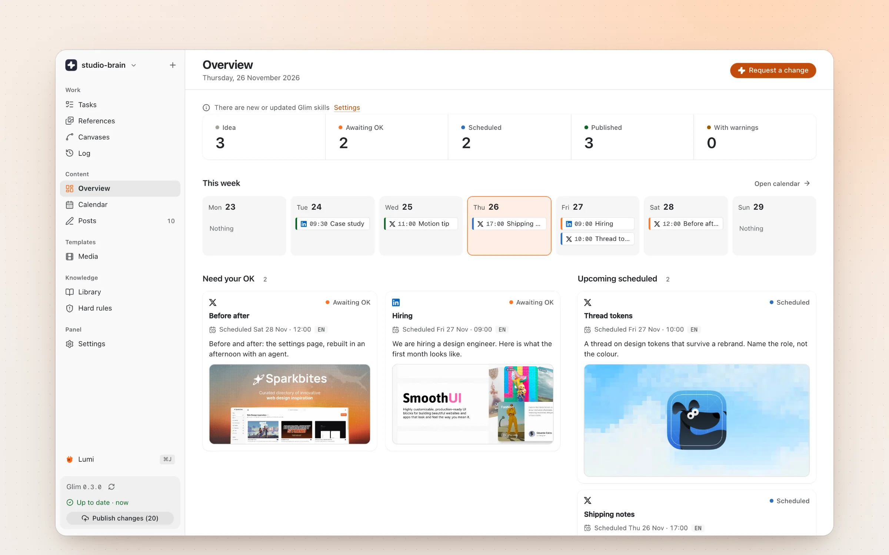

<div align="center">

# Glim

**AI agents on your content repo.** A Mac app where Claude Code, Codex, Cursor or OpenCode edit your drafts, templates and references locally, and every change ships as a reviewed pull request.

[Get started](#get-started) · [Features](#features) · [How it works](#how-it-works) · [Español](README.es.md)

</div>

<picture>
  <source media="(prefers-color-scheme: dark)" srcset="docs/media/overview-dark.webp">
  
</picture>

## Why Glim

Your writing, rules and references already live best as plain files in a git repo: versioned, portable and readable by any agent. What is missing is a calm place to point an agent at them, watch what it does, and decide what goes out.

Glim is that place. It opens a **brain** (any git repo with a `glim.config.json`), runs the agents you already have installed, and never stores anything of its own. Close Glim and your repo is still just your repo.

A *glim* is a small light: just enough, right where you need it.

## Features

- **Ask for a change.** Point at a post, a template or a reference and describe what you want. The agent works in the background, in a queue, and you see live what it reads, edits and runs. "Another pass" resumes the same session. You get a system notification when it finishes or fails.
- **Bring your own agent.** Claude Code, Codex, Cursor Agent, OpenCode, Gemini CLI or a custom command. Glim detects which ones are installed.
- **Posts and calendar.** Markdown drafts per network with preview, a real character counter, warnings and a calendar that shows the gaps in your cadence. Drag a post to another day to reschedule it.
- **References.** Links, screenshots and videos with colour palettes, search by colour, ratings, duplicate detection, readers for X, Instagram, YouTube and more, and page snapshots. Free-form canvases to gather references and notes and hand them to an agent. Inspired by [Pond](https://github.com/raphaelsalaja/pond).
- **Publish with review.** One button checks for secrets and private paths, drafts the commit message, opens a pull request, reviews it against your rules, waits for CI and merges, with a cancellable countdown. Nothing leaves your Mac until you press it.
- **Buffer, read only.** What is scheduled or published in Buffer shows up on your drafts. Glim never creates or schedules anything there.
- **Native.** System blur, a Dock badge for what needs review, menu bar, global shortcut, custom icon, sounds, light and dark.

<picture>
  <source media="(prefers-color-scheme: dark)" srcset="docs/media/posts-dark.webp">
  
</picture>

## Get started

**Requirements:** macOS, Node 20.19+, Python 3 with Pillow, `git`, and at least one agent CLI (for example `npm i -g @anthropic-ai/claude-code`). Optional: `gh` to clone and publish, `ffmpeg` and `yt-dlp` for video references.

```bash
git clone https://github.com/educlopez/glim && cd glim
npm ci
npm run app:instalar      # builds Glim.app and copies it to ~/Applications
```

On first launch Glim asks for a brain: a folder on this Mac, a GitHub repo (`user/repo`, using your `gh` session) or a new one created with the minimum files. See [`ejemplos/cerebro-minimo`](ejemplos/cerebro-minimo) for a small example and [`docs/cerebro.md`](docs/cerebro.md) for every `glim.config.json` option.

Installed this way, Glim follows the `main` branch of this repo: it tells you when a new version is out, updates in one click and shows what changed.

The interface comes in English and Spanish. It follows the brain's `idioma` setting, then your system language; you can also pick one in Settings.

## How it works

```text
your brain (git repo)          Glim (local)                    your agents
├── glim.config.json   ──▶     server on 127.0.0.1    ──▶     claude · codex · cursor
├── AGENTS.md (rules)          queue of tasks                  opencode · gemini · custom
├── drafts, media              live log of each run
└── references, canvases       publish: checks → PR → review → CI → merge
```

- Everything runs on your Mac. The server listens only on `127.0.0.1` with a token per launch.
- Service keys (Buffer, Dub) live in the macOS Keychain, never in the repo.
- Paths you mark as private are never served or pushed.

Details and how to report a vulnerability: [SECURITY.md](SECURITY.md). Architecture: [docs/arquitectura.md](docs/arquitectura.md).

## Development

```bash
GLIM_BRAIN=./ejemplos/cerebro-minimo npm run dev   # UI and API on http://127.0.0.1:4321
npm run app                                        # Electron on the same code
npm run check                                      # lint, tests and build
```

See [CONTRIBUTING.md](CONTRIBUTING.md). Issues and pull requests are welcome.

## Status

Used daily by its author and open to anyone who wants to try it. macOS only.

## License

[MIT](LICENSE). Geist Mono is bundled under the SIL Open Font License 1.1.
